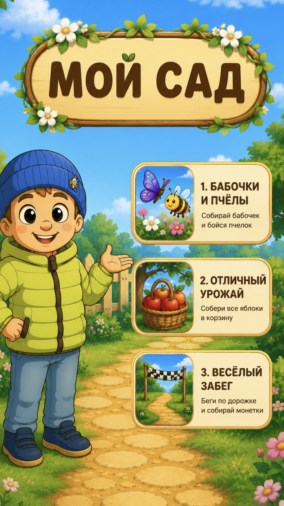
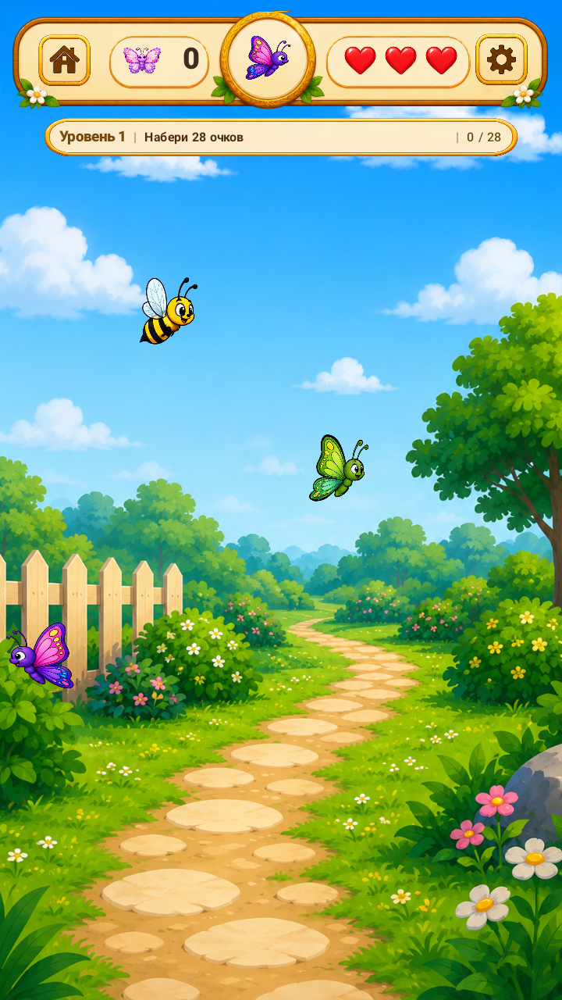
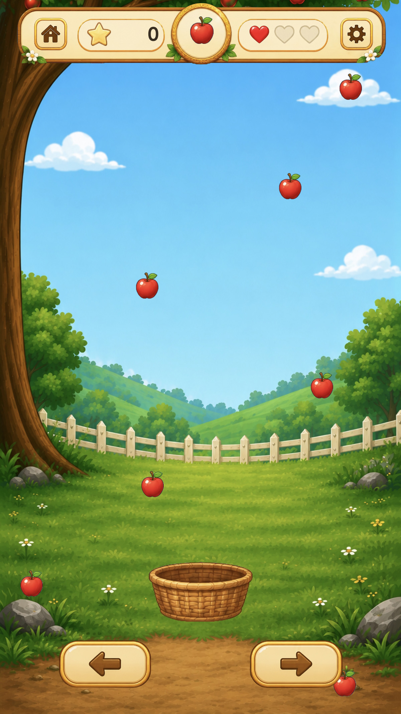
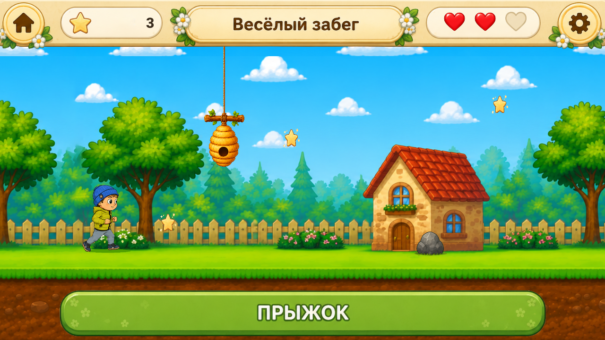

# My Garden / Мой сад

[Русская версия](README.ru.md) · [Download on RuStore](https://www.rustore.ru/catalog/app/com.example.mygarden)

**Native Android game for children · Production release: June 2026**

An independently developed mobile game with three garden-themed mini-games: Butterflies and Bees, Apple Harvest and Fun Run. The project focuses on simple game interactions and colorful visuals for young children.

## Technology

- Kotlin 2.2.10, Jetpack Compose, Material 3
- Android Studio, Android Gradle Plugin 9.2.1, Gradle 9.4.1
- AndroidX DataStore Preferences and Lifecycle
- Android 7.0+ (API 24); target API 36

## Product development

I developed and published the game independently, using OpenAI Codex as an AI coding assistant and generative AI to create visual assets. The project demonstrates end-to-end mobile product delivery, from concept and implementation to a production release on RuStore.

## Run locally

1. Clone the repository and open the root directory in Android Studio.
2. Configure a compatible Gradle JDK and install Android SDK 36.1.
3. Sync Gradle and run the app configuration on an Android device or emulator (API 24+).

On Windows, a debug build can be requested with `gradlew.bat assembleDebug` after configuring the SDK and JDK.

## Screenshots

  
  
  

  

Main menu and all three mini-games. Actual application screenshots.

## Assets and rights

Visual assets were created by the developer using generative AI. Music and sound effects are third-party assets whose individual license and redistribution terms remain to be verified. See [asset notices](THIRD_PARTY_NOTICES.md). Public repository visibility does not constitute an open-source license.
