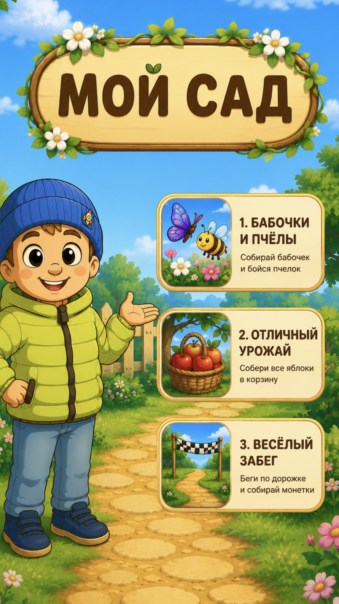
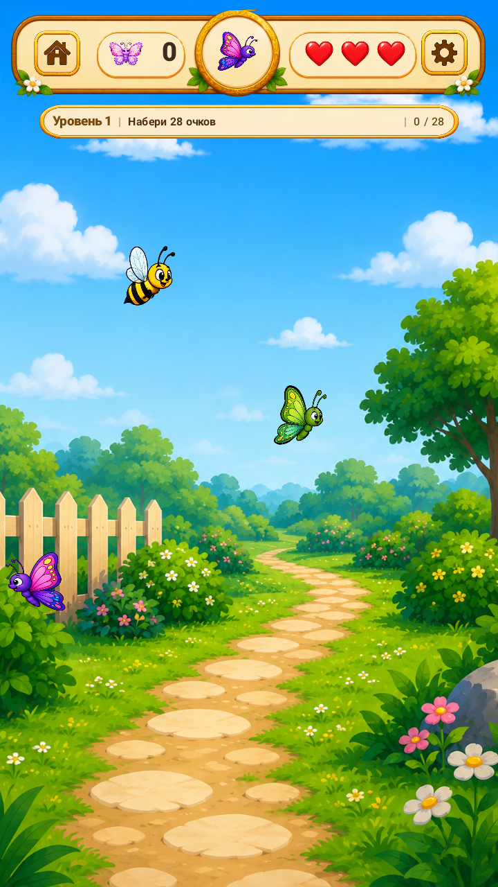
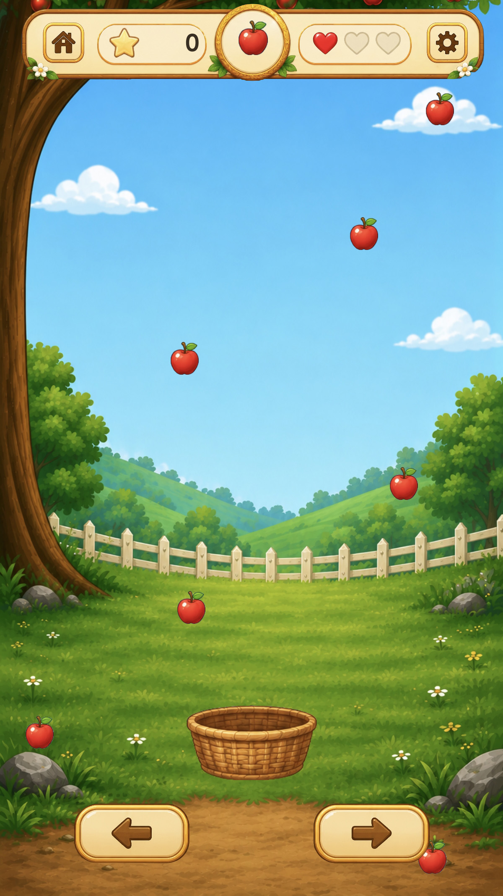
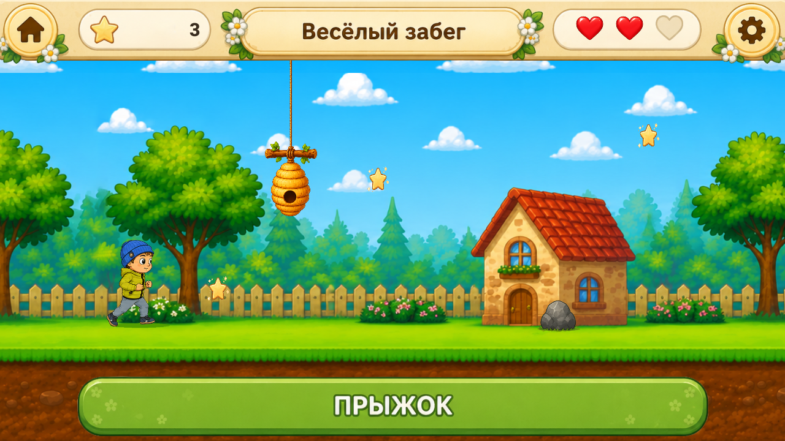

# Мой сад

[English version](README.md) · [Игра в RuStore](https://www.rustore.ru/catalog/app/com.example.mygarden)

**Детская Android-игра · Релиз в июне 2026 года**

Самостоятельно разработанная мобильная игра с тремя мини-играми: «Бабочки и пчёлы», «Отличный урожай» и «Весёлый забег». Основной акцент — простое управление и яркая графика для маленьких детей.

## Технологии

Kotlin 2.2.10, Jetpack Compose, Material 3, Android Studio, Gradle 9.4.1, AndroidX DataStore. Минимальная версия Android — 7.0 (API 24), целевая — API 36.

## Разработка

Игра самостоятельно разработана и опубликована автором с использованием OpenAI Codex. Графика создана автором с помощью генеративного ИИ. Проект демонстрирует полный цикл разработки мобильного продукта — от идеи до публикации в RuStore.

## Запуск

Клонируйте репозиторий, откройте его в Android Studio, настройте совместимый Gradle JDK и Android SDK 36.1, синхронизируйте Gradle и запустите конфигурацию app на устройстве или эмуляторе с API 24+.

## Скриншоты

  
  
  

  

Главное меню и три мини-игры. Скриншоты приложения.

## Авторство и лицензии

Музыка и звуки — сторонние ресурсы; условия их распространения требуют проверки. Подробнее: [THIRD_PARTY_NOTICES.md](THIRD_PARTY_NOTICES.md). Публичный доступ к репозиторию не означает предоставление открытой лицензии.
